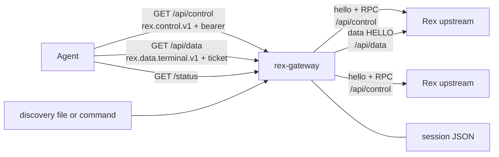
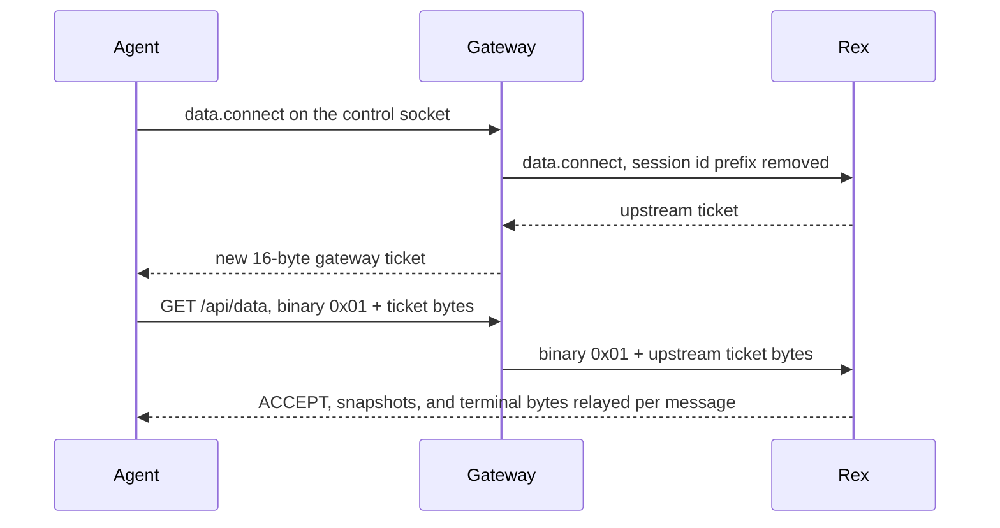

**English** · [简体中文](README.zh-CN.md)

# Rex Gateway

Rex Gateway is a control and data gateway you run in front of one or more Rex servers you operate. Agents keep using the Rex WebSocket protocols. The gateway is the process they dial: one listen address, one bearer token, and a stable session id when several Rex hosts sit behind it.

It is a single Rust binary in this repository (`rex-gateway`). It does not embed a Rex server, a Rex agent, or the `rex` CLI.

## Use it when

- Several Rex hosts should look like one endpoint to an agent.
- Session ids from different hosts must not collide (`local:session:…` versus another upstream's prefix).
- A new `session.create` should prefer a healthy, lightly loaded host, and a dead host should not be the only try.
- An agent should keep a session reference across a gateway restart, while the Rex process itself still owns the live session.
- Upstream hosts come and go through a `rex-discover --json` snapshot, without dropping sessions that are already open.

## What it does

- Authenticates `GET /api/control`, `GET /api/data`, and `GET /status` with a bearer token before any WebSocket upgrade.
- Speaks `rex.control.v1`. The welcome message's `api_server_revision` is **31**.
- Fans `session.list` out to every allowed upstream and prefixes session ids with the upstream id.
- Routes a namespaced session call back to that upstream, and routes a hostless `session.create` or other hostless call with the rules in [Routing and failover](#routing-and-failover).
- Rewrites nested `ticket` strings to single-use gateway tickets and bridges `rex.data.terminal.v1` byte-for-byte.
- Remembers `upstream:session:…` references in a local JSON file.
- Probes upstreams, optionally refreshes them from a discovery file or command, and exposes `GET /status`.

The gateway forwards Rex methods it does not special-case. It does not implement the Rex method set itself. A method Rex does not know is Rex's error, passed through as Rex sent it.

## Before you expose it

- The listen socket is plaintext HTTP. The example config binds `127.0.0.1:7300`. Putting that socket on a wider network exposes bearer tokens and terminal bytes.
- Outbound `https://` upstreams use Rustls and the process's native trust store. This binary does not terminate TLS for agents.
- Tokens live in the TOML file. There is no token HTTP API.
- `session.forget` and idle expiry drop the gateway's reference. They do not delete the Rex session.
- The welcome `client.reconnect_token` is a fresh UUID per connection. The gateway does not store it or accept it later. Reconnect by opening a new control socket and sending `hello` again.
- This repository has no license file and no published install package. Build from source.

Details and the exact error strings are in the sections below.

## Architecture



The listen socket opens without waiting for Rex. Control clients connect on their first call, and the probe loop's first pass starts immediately, so that pass is usually the first dial. A down upstream does not stop the listen socket.

Data attach, after the agent already has a gateway ticket:



## Prerequisites

- A Rust toolchain newer than 1.83. This crate is edition 2021, but locked `zeroize` 1.9.1 requires Cargo's `edition2024` feature, which Cargo 1.83 rejects. The [Development](#development) section names the toolchain used to run `cargo test` for this tree.
- A Rex server reachable at the upstream URL you configure, when you want live sessions. This repo does not build or vendor Rex.
- Python 3 standard library only, and only for the live scripts under the repo root. `cargo test` does not need Python or Rex.

Outbound HTTPS uses `tokio-tungstenite` with `rustls-tls-native-roots` (see `Cargo.toml`).

## Quick start

From a checkout of this repository (`https://github.com/LVtomatoJ/rex-gateway`). The tracked [`rex-gateway.toml`](rex-gateway.toml) listens on `127.0.0.1:7300`, probes every 1000 ms, points upstream `local` at `http://127.0.0.1:7297`, and uses the example token `smoke-secret`. Replace that token before use.

```sh
cp rex-gateway.toml my-gateway.toml
# edit my-gateway.toml: set [[auth.tokens]] token to a value you choose
REX_GATEWAY_CONFIG=my-gateway.toml RUST_LOG=info cargo run --locked
```

`cargo run --locked` with no `REX_GATEWAY_CONFIG` reads `./rex-gateway.toml` instead. The process logs `gateway listening` at info. It keeps listening if `127.0.0.1:7297` is closed. That upstream starts as `Unknown` and becomes `Offline` after two failed probes.

With the example token and listen address still in place:

```sh
curl -sS -H 'Authorization: Bearer smoke-secret' http://127.0.0.1:7300/status
```

A missing or wrong token is HTTP 401. `GET /status` also sends `WWW-Authenticate: Bearer`.

Build a binary without running it:

```sh
cargo build --locked
./target/debug/rex-gateway
```

The binary name is `rex-gateway`. There is no library crate and no install script.

## Configuration

A second upstream and a token that may use only one of them:

```toml
listen = "127.0.0.1:7300"
probe_interval_ms = 1000

[[upstreams]]
id = "local"          # must not contain ":"; it is the session-id prefix
url = "http://127.0.0.1:7297"
tags = ["perf", "ci"]
description = "Local performance compile host"

[[upstreams]]
id = "build-mac"
url = "https://mac.example:7297"
tags = ["macos", "perf"]

[[auth.tokens]]
token = "replace-me"
allow = ["local"]     # "*" allows every current and future upstream id
prefer_tags = ["perf"]
avoid_tags = []
prefer_hosts = ["local"]
avoid_hosts = []
```

`url` is the Rex HTTP base. The gateway appends `/api/control` and `/api/data` and switches `http` to `ws` and `https` to `wss`. Userinfo in that URL is used when dialing and stripped from `GET /status`.

Every key, default, and environment override is in [Configuration reference](#configuration-reference). Tokens and the token list are TOML-only. Environment variables can replace listen address, timeouts, limits, the `local` upstream URL, tag and host preference lists, and discovery settings. They cannot add a token.

## Agents and Rex clients

Anything that already speaks Rex to one server can speak it to the gateway instead. This repository does not ship a client SDK. The Python files here are live checks, not a library.

1. `GET /api/control` with `Sec-WebSocket-Protocol: rex.control.v1` and `Authorization: Bearer <token>`. The scheme is case-sensitive and the token must match exactly, with one space after `Bearer`.
2. Send a text frame `{"type":"hello"}`. The next text frame is the welcome.
3. Send `{"type":"request","id":"<you choose>","method":"<rex method>","payload":{...}}`.
4. Read `{"type":"response","id":"<same id>","seq":<n>,"payload":...}` or, for a Rex frame error, the same object with `error` and no `payload`.
5. For a terminal, call `data.connect`, then open `GET /api/data` with `rex.data.terminal.v1` and the same bearer. The first binary frame is `0x01` followed by the raw 16 ticket bytes, not the base64 text.

Welcome shape (ids are new on every connection):

```json
{
  "type": "welcome",
  "protocol": "rex.control.v1",
  "api_server_revision": 31,
  "limits": {
    "max_message_bytes": 1048576,
    "max_in_flight_control_rpcs": 16
  },
  "client": { "id": "client:<uuid>", "reconnect_token": "<uuid>" }
}
```

Both limits are fixed in code. `max_message_bytes` is also the WebSocket `max_message_size` and `max_frame_size` on the agent control socket, the agent data socket, and both upstream sockets.

Use session ids exactly as the gateway returned them (`local:session:<uuid>`). A bare `session:<uuid>` is not sticky: with no `host` it is treated as a hostless call. `wrap` of an id that already has an `upstream:session:` prefix does not add a second prefix.

`session.bootstrap` and `session.attach` need Rex's `event_scope` of `"session"` or `"all"`. The gateway does not add it. Rex's frame error is forwarded unchanged. [`smoke.py`](smoke.py) uses `session.attach` for that reason. [`smoke_tags.py`](smoke_tags.py) uses `session.bootstrap`.

The external `rex` CLI is not part of this binary. [`smoke_data.py`](smoke_data.py) shells out to `rex` (or `REX_BIN`) against the upstream URL `http://127.0.0.1:7297` to type into a terminal. That path does not go through the gateway.

Gateway-only method: `session.forget` with `{"session_id":"<upstream>:session:<uuid>"}`. See [Session references](#session-references).

## Routing, discovery, and sessions

Short version. Exact order, errors, and counters are below.

**List.** `session.list` ignores its payload. Every ACL-allowed upstream that is `Online` or `Degraded` is queried at once. Results are concatenated in upstream-id order, keeping each Rex host's own order. `Offline` and `Unknown` are skipped. A partial failure adds `partial: true`, `failed_upstreams`, and `upstream_errors`. If every allowed upstream fails, the call errors with `all upstreams failed: …`. An ACL that names nothing returns `{"sessions":[]}`.

**Sticky call.** A payload `session_id` of the form `<upstream>:session:…` goes only to that upstream, with the prefix removed. The id must be allowed. `Offline` or `Unknown` returns `upstream <id> is Offline|Unknown; the owning upstream is unavailable, remove/recreate this session`. There is no failover.

**Create.** No `session_id` and no `host`: the gateway reserves the best `Online` or `Degraded` upstream that still accepts creates, under your tag and host preferences, then calls it. A transport failure releases the reservation, marks that upstream, and tries the next candidate. An application error or a payload `host` does not. A pinned `host` that is `Offline` or `Unknown` returns `upstream <id> is Offline|Unknown; pinned host is unavailable — wait until it is Online or Degraded, or choose a different host` (there is no session to remove yet). The same pinned-host Offline copy applies to every other method that names `host` without a namespaced `session_id` (for example `server.version`).

**Other hostless calls.** No `session_id` and no `host` (`server.version` and anything else): try `Manual` before discovered, `Online` before `Degraded`, then upstream id. Same transport-only failover.

**Discovery.** Optional. A command or a JSON file fills non-manual upstreams. Manual entries are never replaced. Hosts that disappear stay only while a remembered session still points at them, and they stop receiving new creates.

**Sessions.** The on-disk map survives a gateway restart. It does not keep the Rex process alive, and a later `session.list` or event that sees the same session clears a previous forget.

## Development

`cargo test --locked` is the check that runs entirely inside this repository. It does not need a Rex server. It covers config parsing, auth, ticket TTL and ownership, ticket restore, session restart / TTL / capacity, discovery apply rules, probe state, routing, failover, frame-error pass-through, data-plane close codes (including forgotten-session binary REJECT, Offline attach refuse, and finishing the agent sink after an unexpected upstream drop), event-lag notices, control-response idle refresh (including in-flight overflow replies), host-pin offline errors, the control-plane in-flight bound, panic-safe in-flight slot release, hung upstream-control pending RPC reap, and agent WebSocket frame/message caps at 1 MiB.

```sh
cargo test --locked
cargo build --locked
```

On this tree, `cargo test --locked` passed 135 tests with rustc 1.99.1. `--locked` keeps the build on `Cargo.lock`; Cargo 1.83 cannot parse it.

The live scripts assume the repository root as the working directory, `127.0.0.1:7300`, and token `smoke-secret`. They are not part of `cargo test`.

| Script | What it asserts | What has to already be true |
| --- | --- | --- |
| [`smoke.py`](smoke.py) | 401 without a token and with the wrong token; welcome; a `local:session:` id from `session.list`; `server.version`; `session.attach` with `event_scope` `session` | Example config, and at least one session on an upstream the token can list |
| [`smoke_data.py`](smoke_data.py) | Gateway ticket is 16 bytes; data ACCEPT `0x81`; snapshot and `HELLO_FROM_GATEWAY` bytes; reused ticket is `0x82 0x01` and close 1008 | A listed session with a focused block, and `rex` on `PATH` (override with `REX_BIN`) |
| [`smoke_tags.py`](smoke_tags.py) | `session.bootstrap` reports `local` tags `perf`/`ci`; unsatisfiable `prefer_tags` errors; `/status` shows those tags | Same example upstream metadata, and a live session |
| [`smoke_ttl.py`](smoke_ttl.py) | Reaper clears an unused ticket; late HELLO is `0x82 0x01`; gauges return to zero | Gateway started with `REX_GATEWAY_TICKET_TTL_MS=2000`, plus the hardcoded session and block at the top of `smoke_data.py` (this script does not discover them) |
| [`smoke_sessions.py`](smoke_sessions.py) | Attach and data ACCEPT using a listed reference; `--check-gc` checks `session.forget`; `--after-ttl` expects `session reference expired/forgotten` | A listed session. The restart step is manual: stop and start the gateway on the same `REX_GATEWAY_SESSION_STORE_PATH`. The script also sends `session.rename`, which `smoke.py` notes current Rex no longer implements. A frame error there fails the script |

`smoke_sessions.py` flags: `--expect-ref`, `--after-ttl SECONDS`, `--check-gc`.

Logs use `tracing-subscriber`'s `RUST_LOG` filter (`RUST_LOG=info` is a useful starting point). Nothing in this process handles `SIGTERM` itself; stopping the process stops the listen socket. In-memory tickets are not written to disk.

## Configuration reference

File path: `REX_GATEWAY_CONFIG`, default `rex-gateway.toml`.

| Setting | Default | Environment override |
| --- | --- | --- |
| `listen` | `127.0.0.1:7300` | `REX_GATEWAY_LISTEN` |
| `probe_interval_ms` | `10000` | `REX_GATEWAY_PROBE_INTERVAL_MS` |
| `ticket_ttl_ms` | `30000` | `REX_GATEWAY_TICKET_TTL_MS` |
| `ticket_max` | `1024` | `REX_GATEWAY_TICKET_MAX` |
| `upstream_call_timeout_ms` | `10000` | `REX_GATEWAY_UPSTREAM_CALL_TIMEOUT_MS` |
| `data_connect_timeout_ms` | `10000` | `REX_GATEWAY_DATA_CONNECT_TIMEOUT_MS` |
| `ws_ping_interval_ms` | `20000` | `REX_GATEWAY_WS_PING_INTERVAL_MS` |
| `ws_idle_timeout_ms` | `120000` | `REX_GATEWAY_WS_IDLE_TIMEOUT_MS` |
| `max_data_streams` | `128` | `REX_GATEWAY_MAX_DATA_STREAMS` |
| `max_data_streams_per_token` | `32` | `REX_GATEWAY_MAX_DATA_STREAMS_PER_TOKEN` |
| `max_control_connections` | `128` | `REX_GATEWAY_MAX_CONTROL_CONNECTIONS` |
| `max_control_connections_per_token` | `32` | `REX_GATEWAY_MAX_CONTROL_CONNECTIONS_PER_TOKEN` |
| `create_reservation_ttl_ms` | `5000` | `REX_GATEWAY_CREATE_RESERVATION_TTL_MS` |
| `session_store_path` | `rex-gateway-sessions.json` | `REX_GATEWAY_SESSION_STORE_PATH` |
| `session_ttl_ms` | `86400000` | `REX_GATEWAY_SESSION_TTL_MS` |
| `session_max` | `16384` | `REX_GATEWAY_SESSION_MAX` |
| `discovery.file` | unset | `REX_GATEWAY_DISCOVERY_FILE` |
| `discovery.command` | unset | `REX_GATEWAY_DISCOVERY_COMMAND` |
| `discovery.interval_ms` | `30000` | `REX_GATEWAY_DISCOVERY_INTERVAL_MS` |
| `discovery.store_path` | unset | `REX_GATEWAY_DISCOVERY_STORE_PATH` |
| upstream `local`'s `url` | from TOML | `REX_GATEWAY_UPSTREAM_LOCAL_URL` |
| one upstream's `tags` | from TOML | `REX_GATEWAY_UPSTREAM_<exact id>_TAGS` (comma-separated) |
| one upstream's `description` | from TOML | `REX_GATEWAY_UPSTREAM_<exact id>_DESCRIPTION` |
| token `prefer_tags` / `avoid_tags` / `prefer_hosts` / `avoid_hosts` | from TOML | `REX_GATEWAY_AUTH_TOKEN_<index>_PREFER_TAGS` and the matching `_AVOID_TAGS`, `_PREFER_HOSTS`, `_AVOID_HOSTS` |

`<index>` is the zero-based position in `auth.tokens`. `<exact id>` is the TOML id, including hyphens (`REX_GATEWAY_UPSTREAM_high-mem_TAGS`). Comma lists are trimmed; empty pieces are dropped. Setting one of those variables to an empty string stores an empty list.

`REX_GATEWAY_DISCOVERY_COMMAND` is split on ASCII whitespace with no quoting. Use the TOML array when an argument contains spaces. A whitespace-only value clears the command.

Rejected at startup: no token; empty token or empty `allow`; duplicate token strings; no upstream unless discovery is enabled; any required nonzero setting set to `0` (probe interval, both timeouts, ticket TTL and cap, both WebSocket timers, both data caps, both control caps, reservation TTL, session TTL and cap, and discovery interval when discovery is on); `ws_idle_timeout_ms` less than or equal to `ws_ping_interval_ms`; empty session store path; empty discovery program when `command` is set.

The example file sets `probe_interval_ms = 1000`, which overrides the 10 second default.

These are not configurable: WebSocket message cap (1 MiB), in-flight control RPCs per agent connection (16), upstream control command queue (64), event broadcast capacity (1024), probe RPC budget (4 seconds inside a 5 second cap), reconnect backoff (200 ms, doubled, capped at 5 seconds).

## Authentication and security

`Authorization: Bearer <token>` is required on all three routes. The WebSocket routes also require the matching subprotocol and return HTTP 400 when it is missing. Comparison strips one `Bearer ` prefix, hashes the remainder with SHA-256, and checks that digest against every configured digest in constant time with no early exit. `bearer`, two spaces, a trailing space, or a missing scheme do not match.

Each token has an `allow` list of upstream ids, or `"*"`. `session.list`, `GET /status`, sticky routing, and `session.bootstrap`'s `upstreams` array all honor it. Counters on `/status` are process-wide and are not filtered.

A data ticket is bound to the exact `Authorization` header string of the control call that created it. Another configured token cannot take it. A wrong owner does not consume the ticket. The comparison is constant-time; its duration follows the string lengths, not the first differing byte.

The authenticator stores digests. The loaded config object still holds the plaintext tokens until the process exits. Tickets and the upstream ticket they map to stay in memory only.

`GET /status` removes URL userinfo, query, and fragment, and replaces the raw upstream URL inside `last_error` with that redacted form.

A discovery `command` is spawned as an argument vector, not a shell, with the gateway's user and environment. Its stdout is parsed as upstream addresses. Treat that command like configuration.

## Control protocol

Only text frames whose `type` is `request` are dispatched. Invalid JSON and any other type are ignored. The first frame must be `hello`; anything else closes the socket before welcome.

Each agent connection runs at most 16 upstream calls at once. The socket loop stays responsible for inbound frames, event forwarding, pings, and idle close while those calls are in flight. A panicked handler still frees its slot and answers with `payload.error` `control RPC task panicked` so capacity does not leak until reconnect. Overflow is immediate and does not call upstream:

```json
{"type":"response","id":"<id>","seq":1,"payload":{"error":"too many in-flight control RPCs"}}
```

Gateway failures use `payload.error` as a string. Rex frame errors (`{"code","message","status"}` and no payload on the Rex response) are copied to the agent's top-level `error` and are not rewritten into `payload`. They do not get `session.bootstrap` decoration, and they are not replaced with `upstream data.connect omitted ticket`. A successful `data.connect` payload that has no string `ticket` does produce that gateway error, including a payload whose only field is a payload-level `error`.

`seq` is one counter per agent connection for responses and events, assigned when the frame is written. The agent `id` is echoed by the gateway and is not the id used on the upstream socket. Upstream calls use a new UUID. Events and responses can therefore interleave in `seq` order.

Events whose upstream the token cannot access are dropped. Each forwarded copy is namespaced once for that agent, so each agent gets its own gateway tickets. The broadcast channel holds 1024 events. A slow agent skips the gap. `events_lagged` adds that gap's count (`RecvError::Lagged(n)` adds `n`). The agent also gets one synthetic event, which shares the same `seq` counter:

```json
{"type":"event","seq":1,"payload":{"gateway":{"notice":"events_lagged","skipped":4}}}
```

Missed upstream events are not replayed. `events_forwarded` counts successful sends of upstream events only, so several agents count several times for one upstream event, and the lag notice is not included. `skipped` is a JSON number (the `u64` count).

`session.list` rewrites nested `session_id` and `ticket` fields the same way other responses do. Items without a string `session_id` that starts with `session:` are dropped.

On `session.bootstrap` success the gateway adds:

- `upstream`: `id`, `tags`, `description`, `state`, `latency_ms`, `session_count` for the owner.
- `upstreams`: the same fields plus `reserved_session_count` and `effective_session_count`, for every ACL-allowed upstream in any state, sorted by id.

Routing hints removed before a payload is forwarded: `host`, `prefer_tags`, `avoid_tags`, `prefer_hosts`, `avoid_hosts`.

## Routing and failover

**Health used for routing.** `Online` and `Degraded` are routable. `Offline` and `Unknown` are not. Probes are independent of `upstream_call_timeout_ms`: each probe is a `session.list` with a 4 second call timeout inside a 5 second cap, run concurrently across upstreams. A reply that contains a `sessions` array and finishes in 1000 ms or less is `Online`. Slower than 1000 ms, or a reply with no `sessions` array, is `Degraded` (latency is kept; `last_error` is set only in the missing-array case). A probe that got a `sessions` array clears `consecutive_failures` and `last_error`. Any probe failure moves the upstream to `Degraded` on the first failure and `Offline` on the second consecutive failure, clears latency, and sets `session_count` to 0. The probe loop starts immediately, then waits `probe_interval_ms` between passes. The example file's interval is 1 second; the default when the key is omitted is 10 seconds.

**Manual upstreams** are the `[[upstreams]]` table (`source` `Manual`). Discovered ones are `Tailnet` or `Lan`.

**Hostless non-create order** (`pick_default`): among ACL-allowed, routable upstreams that still accept creates, sort by Manual before anything else, then `Online` before `Degraded`, then id ascending. Take the first. Transport failure marks that upstream (the same failure counter as a probe) and tries the rest, excluding ids already tried for this request. Application errors, including Rex frame errors and a payload `error` field, stop at that upstream. Exhaustion is `<method> failed on all candidates: <id>: <reason>; …`. If nothing was eligible before any attempt, the error is `no routable upstream`.

**`session.create` without `host`.** Preferences come from the request when the field is a JSON array, otherwise from the token. A non-array value leaves the token default in place. An empty array clears that list for this call. Tags and host lists on the request are not merged with the token.

Tags are a filter, not a tie-break. Every `prefer_tags` entry must be present. Any `avoid_tags` or `avoid_hosts` hit removes the upstream. Among what remains, the score is:

- `1_000_000` if `Online`, else `0`
- `50_000` if the id is in `prefer_hosts`
- minus `session_count + reserved_session_count`

Higher score wins. Then lower `latency_ms`, with a missing latency last. Then id ascending. After the tag filter, extra tags do not change the score. Inside one health band, a preferred host beats another unless its effective load is more than 50,000 higher. An Online host still outranks a preferred Degraded host unless the Online host's effective load is more than 950,000 higher. A missing preferred host is skipped; that case is not an error. Avoid lists do not hide sessions from `session.list`.

Explicit unusable preferences return:

- `no allowed upstream`
- `no routable upstream: all allowed upstreams are Offline or Unknown`
- `no allowed upstream accepts creates`
- `no upstream matches required tags [<tags>]; change tag requirements or wait for a matching upstream`
- `no upstream matches: all matching candidates are excluded by avoid_tags or avoid_hosts`

Selection and the reservation counter share one mutex, so overlapping creates see each other's reservation. The reservation lasts until the attempt finishes or `create_reservation_ttl_ms` (default 5000) passes, and is reaped on the next selection and on `GET /status`. A transport failure drops it and continues. The agent-facing exhaustion string is `session.create failed on all candidates: <id>: <reason>; …`.

A payload `host` on any method, including create, skips scoring, reservations, and failover. It must be ACL-allowed and routable. It may name a discovered upstream that no longer accepts automatic creates. Unknown id: `upstream <id> is unknown`. ACL miss: `upstream <id> is not allowed`. `Offline` or `Unknown` on a host-pinned call (any method, including `session.create` and `server.version`) returns `upstream <id> is Offline|Unknown; pinned host is unavailable — wait until it is Online or Degraded, or choose a different host`. The same states on a namespaced session call still return `upstream <id> is Offline|Unknown; the owning upstream is unavailable, remove/recreate this session`.

Transport errors that do failover are the control client's errors: connect failure, timeout, missing client, socket closed, and `upstream unavailable (retry in <ms> ms): …` while reconnect backoff is in effect. Backoff after a failed connect is 200 ms, doubled, capped at 5 seconds. During the wait the call fails fast with that `retry in` text instead of dialing again.

`/status` counts each failed automatic hop in `create_transport_failovers` or `hostless_transport_failovers`, and each exhaustion in `create_failover_exhausted` or `hostless_failover_exhausted`. Pins and application errors do not increment them.

While an upstream is backing off, new calls fail until `retry in` elapses. The client object itself is created at startup or discovery time and does not fail construction.

## Data plane

`GET /api/data` uses `rex.data.terminal.v1` and the same bearer header. Auth runs before the upgrade. The control socket does not have to stay open for the data socket to run. Upstream Rex may still have its own attach lifetime; this gateway does not close the data bridge just because the control socket closed. `smoke_data.py` checks that order.

Every nested string field named `ticket` in a response or event is replaced with a new 16-byte id, base64url without padding. The real upstream ticket stays in memory, bound to the bearer, single-use, and unused for at most `ticket_ttl_ms`. Each rewritten ticket is also bound to the nearest enclosing namespaced `session_id` in that JSON object (a nested object's own `session_id` wins over its parent). A `data.connect` payload that has a ticket and no `session_id` of its own uses the request's session id. That covers tickets from `session.list`, `session.bootstrap`, `session.create`, events, and `data.connect`. At `ticket_max` pending tickets the oldest is evicted. The reaper period is half the TTL, clamped to 50 ms … 5 seconds. Expiry is also checked on use.

The agent HELLO is the byte `0x01` plus those 16 raw bytes. The gateway then dials the owner's `/api/data` and sends `0x01` plus the decoded upstream ticket. After that, binary, text, ping, pong, and close frames are forwarded, including close code and reason. The gateway does not parse terminal bytes. It forwards each WebSocket message as one message; it does not promise to preserve fragment boundaries inside a message.

| Condition | Result |
| --- | --- |
| Per-token or global data stream cap (defaults 32 / 128) | Close `1013` `per-token data stream limit` or `gateway data stream limit`. Ticket not consumed |
| No HELLO within `data_connect_timeout_ms` | Binary `0x82 0x05`, close `1008` `HELLO timeout` |
| HELLO not `0x01` plus 16 bytes | Binary `0x82 0x05`, close `1002` `malformed HELLO` |
| Unknown, expired, evicted, already used | Binary `0x82 0x01`, close `1008` `bad or used ticket`. Wrong owner is the same response and does not burn the ticket |
| Ticket's session reference is forgotten | Binary `0x82 0x01`, close `1008` `session reference expired/forgotten`. Ticket stays spent and is not restored |
| Owner upstream missing, or its data URL is not a client request | Close `1011` `upstream unavailable`. Ticket restored |
| Owner upstream is `Offline` | Close `1011` `upstream offline`. Ticket restored (no dial) |
| Upstream dial exceeds `data_connect_timeout_ms` | Close `1011` `upstream connect timeout`. Ticket restored |
| Upstream dial fails | Close `1011` `upstream connection failed`. Ticket restored |
| Stored upstream ticket is not base64url, after the upstream socket is open | Close `1011` `invalid upstream ticket`. Ticket restored |
| Upstream HELLO send fails after the socket is open | Close `1011` `upstream HELLO failed`. Ticket restored |
| Upstream data socket ends without a Close | Close `1011` `upstream offline` if the pool says `Offline`, otherwise `upstream closed`, then the agent sink is finished |
| Forwarding agent bytes to the upstream fails | Close `1011` `upstream closed`, then the agent sink is finished |
| Agent drops without a Close, or agent send fails | Upstream close `1001` `peer closed` |
| No binary or text for `ws_idle_timeout_ms` | Both sides close `1001` `idle timeout` |

Stream caps are checked before the ticket is taken, so close `1013` leaves it usable. A forgotten session is refused after `take` and the ticket stays spent. Failures before the upstream HELLO is delivered — missing upstream, Offline refuse, invalid data URL, connect timeout, connection failed, invalid upstream ticket bytes, or HELLO send failure — put that same external id back with its original creation time, so the TTL does not restart and the agent may retry until expiry. `tickets_consumed` goes up on `take` and down by one on a successful restore. `tickets_restored` increases only when restore puts the ticket back. If the original TTL has already elapsed, restore does not put the ticket back and `tickets_expired` increases. A full map can evict some other oldest ticket to make room for the restored one (`tickets_evicted`). If that external id is already present, restore fails and this ticket stays spent (neither `tickets_restored` nor a consume undo). After a successful HELLO send the ticket is committed (the upstream may have consumed it).

Rex's own ACCEPT (`0x81…`) and REJECT frames are relayed once the bridge is up. The gateway does not invent an ACCEPT.

Control connection caps are separate and happen after the HTTP upgrade, before welcome: close `1013` `per-token control connection limit` or `gateway control connection limit` (defaults 32 / 128).

## Session references

External id: `<upstream-id>:session:<rex session id>`. Learned from `session.list`, `session.create`, a namespaced response, or an event. Stored with the upstream id, the real `session:…` id, and `last_active_ms`.

Default file `rex-gateway-sessions.json` (gitignored under that name). Writes are a temp file in the same directory plus rename. Shape:

```json
{
  "entries": {
    "local:session:abc": {
      "upstream": "local",
      "session_id": "session:abc",
      "last_active_ms": 0
    }
  },
  "forgotten": []
}
```

`session_ttl_ms` defaults to one day. `session_max` defaults to 16384. Both must be nonzero. The reaper period is TTL/4, clamped to 50 ms … 60 seconds. It deletes expired entries, then the least-recently-active entries over the cap (id ascending breaks ties), records them in `forgotten`, and writes the file. A restart cannot bring those entries back by itself.

`session.forget` requires a namespaced id, checks the ACL, adds the id to `forgotten`, and returns `{"forgotten":true|false,"session_id":"…"}`. `forgotten` is false when the id was not in `entries`. Repeating it is safe. The Rex session is not deleted.

Later control calls, list, attach, `data.connect`, and relayed terminal bytes refresh `last_active_ms` in memory. The reaper is what persists those touches. Listing refreshes every session the list returned, and `record` removes that id from `forgotten`. A session Rex still lists therefore comes back after a forget or a TTL drop. An unknown but well-formed `<upstream>:session:…` is accepted for routing even if this file has never stored it (`resolve` does not insert it). A malformed id is `unknown session reference`. A forgotten id is `session reference expired/forgotten` on list/send/read/bootstrap/attach/`data.connect`. A data ticket bound to that id (from list, bootstrap, create, an event, or `data.connect`) gets binary `0x82 0x01` then close 1008 with the same reason, and that ticket is not restored.

Upstream ids must not contain `:`. The prefix is split on the first colon, and the remainder must start with `session:`.

## Upstream discovery

Omit `[discovery]` and the pool is manual only. Discovery is on when `file` or `command` is non-empty. Both set: each refresh runs the command and does not read the file.

```toml
[discovery]
command = ["rex-discover", "--json", "--tailnet-only"]
# file = "discovered.json"   # used only when command is unset
interval_ms = 30000
store_path = "rex-gateway-discovered.json"
```

This repository does not include `rex-discover`, `rex`, or `tailscale`. `command` is whatever you put in the array. The gateway only requires stdout to be a JSON array:

```json
[
  {"source": "tailnet", "name": "Build Mac", "addr": "https://mac.example:7297", "mode": ""}
]
```

`mode` is ignored. `source` of `tailnet` (any case) becomes `Tailnet`; every other value, including empty, becomes `Lan`. `name` is sanitized to an id: ASCII lower case, letters, digits, `-` and `_` kept, other characters become a single `-`, trimmed, and empty names become `discovered`. `addr` must be an HTTP(S) base; a missing scheme is treated as `https://`. Empty addresses are skipped. Two entries that sanitize to the same id: the later one wins. A sanitized id that equals a Manual id is skipped, not merged.

Each command run is limited to `max(interval_ms, 60s)`. The next run waits until this one finishes or hits that limit. Nonzero exit or bad JSON leaves the pool as it was and sets `discovery.last_error` (stderr in that string is truncated to 512 characters). A missing file is not an error: `last_applied` is false and `refresh_count` still increases. A present file that cannot be read is an error.

On apply, new or changed discovered upstreams get a lazy control client and start at `Unknown` until probed. An id that left the snapshot is removed when no remembered session references it. If one does, the upstream stays, `accept_creates` becomes false, and automatic create and hostless routing skip it. A later snapshot that contains the id again turns creates back on. `store_path`, when set, is rewritten on every successful apply (pretty JSON, temp file plus rename) and loaded at startup after Manual entries. The default name `rex-gateway-discovered.json` is gitignored; a different path is not.

The first refresh is scheduled immediately, then every `interval_ms`. `interval_ms` must be nonzero when discovery is enabled.

## Status

`GET /status`, bearer required, returns JSON. `upstreams` is only ids the token may access, any state, sorted by id. `counters` and `discovery` describe the whole process.

Illustrative shape (values depend on the running process):

```json
{
  "upstreams": [
    {
      "id": "local",
      "url": "http://127.0.0.1:7297",
      "source": "Manual",
      "state": "Online",
      "latency_ms": 3,
      "consecutive_failures": 0,
      "last_error": null,
      "last_probe_age_ms": 412,
      "session_count": 2,
      "reserved_session_count": 0,
      "effective_session_count": 2,
      "tags": ["perf", "ci"],
      "description": "Local performance compile host"
    }
  ],
  "counters": {
    "pending_tickets": 0,
    "session_refs": 2,
    "session_forgotten": 1,
    "active_control_connections": 1,
    "active_data_streams": 0,
    "tickets_issued": 5,
    "tickets_consumed": 4,
    "tickets_expired": 1,
    "tickets_evicted": 0,
    "tickets_restored": 0,
    "create_transport_failovers": 0,
    "hostless_transport_failovers": 0,
    "create_failover_exhausted": 0,
    "hostless_failover_exhausted": 0,
    "events_lagged": 0,
    "events_forwarded": 0
  },
  "discovery": {
    "enabled": false,
    "mode": "none",
    "last_success_age_ms": null,
    "last_error": null,
    "last_error_age_ms": null,
    "last_applied": false,
    "refresh_count": 0,
    "error_count": 0
  }
}
```

`state` is `Unknown`, `Online`, `Degraded`, or `Offline`. `source` is `Manual`, `Tailnet`, or `Lan`. `latency_ms` is the last probe latency, or null when that probe failed or none has run. `last_error` is the latest probe or failover error. A later probe that receives a `sessions` array clears it. `session_count` is the last probe's session array length, not a CPU reading. Rex probes do not report CPU.

Gauges, current values: `pending_tickets`, `session_refs`, `session_forgotten`, `active_control_connections`, `active_data_streams`. `tickets_issued`, the failover counters, `events_lagged`, and `events_forwarded` increase for the life of the process. `tickets_consumed` increases on take and decreases when a connect-path failure restores the ticket. `tickets_restored` counts successful restores for the life of the process (failed restores do not bump it). `tickets_expired` counts TTL removals, including a restore that finds the original TTL already elapsed. `tickets_evicted` counts capacity drops, including one done to make room for a restore. `events_lagged` is the sum of skipped upstream events. `events_forwarded` counts delivered upstream events and not the `events_lagged` notice. `session_forgotten` shrinks again if a later list or event records that id.

`discovery.mode` is `command`, `file`, or `none`. Ages are null until that event has happened. `last_applied` is whether the last successful refresh changed the pool from a snapshot. Disabled discovery still returns the object with `enabled: false` and `mode: "none"`.

## Keepalive and idle time

The gateway sends WebSocket pings every `ws_ping_interval_ms` (default 20 seconds) on agent control, agent data, upstream control, and upstream data.

What counts as activity differs:

- Agent control idle is application-idle. Inbound text refreshes it. So does a successfully delivered control response (including the immediate `too many in-flight control RPCs` overflow reply), a successfully forwarded upstream event, and the synthetic `events_lagged` notice. Inbound ping and pong do not. An agent that receives responses, events, or lag notices stays up. An agent with none of that traffic for `ws_idle_timeout_ms` (default 120 seconds) is closed with `1001` `idle timeout`, even while keepalive pings are flowing.
- The upstream control client treats inbound ping, pong, and text as activity. The gateway's pings, once ponged, keep that socket up. On idle it closes the upstream with `1001` `idle timeout` and fails in-flight calls on that socket with `upstream idle timeout`. Independently of idle close, pending RPCs whose caller already timed out (oneshot closed) or that have been waiting longer than `upstream_call_timeout_ms` are reaped on the ping and idle ticks and failed with `upstream response timed out`, so a silent-but-alive upstream cannot leave slots hanging until the next call.
- A data bridge refreshes on binary or text in either direction, not on ping or pong. Idle closes both sides with `1001` `idle timeout`.

`ws_idle_timeout_ms` must be greater than `ws_ping_interval_ms`.

## Known limitations

- Plaintext listen socket. No inbound TLS, no mutual TLS, no token revocation short of editing TOML and restarting.
- `reconnect_token` is not a session.
- Message size, in-flight RPCs, event buffer, and probe timeouts are the constants above, not config.
- Discovered upstreams are inserted with no tags and no description. A non-empty `prefer_tags` list cannot match them. Tag environment overrides apply only to `[[upstreams]]` entries loaded from TOML.
- Automatic routing skips a withdrawn discovered host. An explicit `host` does not.
- Forget, TTL, and the capacity cap do not delete Rex sessions. A later list or event undoes the tombstone for an id Rex still reports.
- Activity timestamps are durable only after the session reaper (or another write) runs.
- The data path is a frame relay, not a terminal codec.
- `smoke_ttl.py` and the `session.rename` calls in `smoke_sessions.py` are tied to one live Rex setup. They are not a portable acceptance suite. `cargo test` is.
