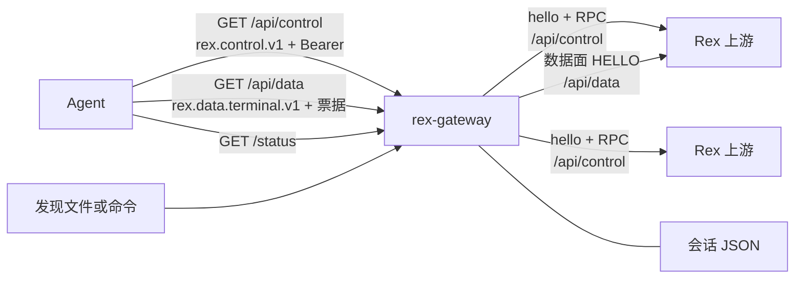
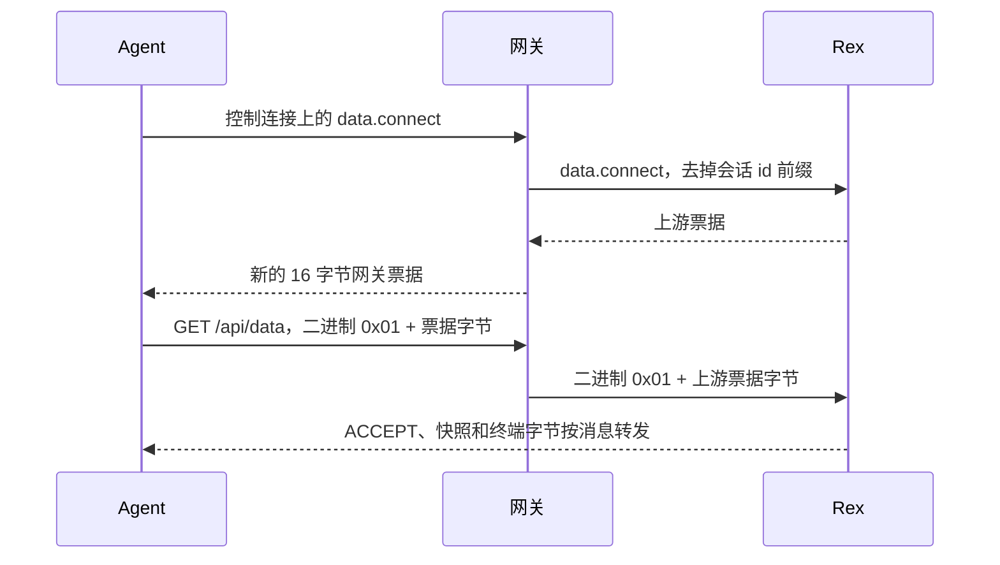

[English](README.md) · **简体中文**

# Rex Gateway

Rex Gateway 是放在你自己的一台或多台 Rex 服务器前面的控制面与数据面网关。Agent 仍然使用 Rex 的 WebSocket 协议。它们只连接网关：一个监听地址、一把 Bearer 令牌，多台 Rex 主机共用一组稳定的会话 id。

本仓库只提供一个 Rust 二进制 `rex-gateway`。其中没有 Rex 服务器、Rex agent，也没有 `rex` 命令行。

## 什么时候用

- 希望多台 Rex 对 agent 表现为一个入口。
- 不同主机上的会话 id 不能撞车（`local:session:…` 与另一台上游的前缀不同）。
- 新建 `session.create` 时优先选择健康、负载较轻的主机，一台挂掉的主机不能成为唯一一次尝试。
- 网关进程重启后，agent 仍能拿着原来的会话引用继续用；真正的会话仍然由 Rex 进程持有。
- 上游主机随 `rex-discover --json` 快照出现或消失，已经打开的会话引用不要因此被丢掉。

## 它做什么

- 在 WebSocket 升级之前，用 Bearer 令牌认证 `GET /api/control`、`GET /api/data` 和 `GET /status`。
- 使用子协议 `rex.control.v1`。欢迎消息里的 `api_server_revision` 是 **31**。
- 把 `session.list` 并发发到每个允许的上游，并给会话 id 加上上游 id 前缀。
- 带上游前缀的会话调用回到那台上游；没有会话 id 的 `session.create` 和其他无主机调用按[路由与故障转移](#路由与故障转移)处理。
- 把嵌套的 `ticket` 字符串换成一次性网关票据，并按消息原样桥接 `rex.data.terminal.v1`。
- 把 `upstream:session:…` 引用记在本地 JSON 文件里。
- 探测上游，也可以从发现文件或命令刷新上游，并提供 `GET /status`。

网关会转发它没有单独实现的 Rex 方法。方法表本身属于 Rex。Rex 不认识的方法，网关按 Rex 返回的错误原样交回。

## 暴露到本机以外之前

- 监听套接字是明文 HTTP。示例配置绑定 `127.0.0.1:7300`。把这个地址放到更大的网络上，Bearer 令牌和终端字节都会暴露。
- 出站 `https://` 上游使用 Rustls 和进程能看到的系统信任库。这个二进制不为 agent 做 TLS 终结。
- 令牌写在 TOML 里。没有管理令牌的 HTTP 接口。
- `session.forget` 和空闲过期丢掉的是网关侧引用，不会删除 Rex 上的会话。
- 欢迎消息里的 `client.reconnect_token` 是每次连接新生成的 UUID。网关不保存它，之后也不接受它。重新连接就是再开一条控制套接字并发送 `hello`。
- 本仓库没有许可证文件，也没有发布安装包。从源码构建。

具体语义和原文错误字符串在后面各节。

## 架构



监听套接字打开时不等待 Rex。控制客户端在第一次调用时才连接；探测循环的第一轮会立刻开始，因此这一轮通常就是第一次拨号。某台上游宕机不会让监听套接字退出。

Agent 已经拿到网关票据之后的数据面附着：



## 环境要求

- 比 1.83 新的 Rust 工具链。本 crate 是 edition 2021，但锁文件里的 `zeroize` 1.9.1 要求 Cargo 的 `edition2024` 特性，Cargo 1.83 会拒绝解析。本文[开发与测试](#开发与测试)一节写明跑通 `cargo test` 时使用的工具链。
- 需要真实会话时，配置里的上游 URL 上要有一台 Rex。本仓库不编译、也不携带 Rex。
- 只有仓库根目录下的现场脚本才需要 Python 3 标准库。`cargo test` 不需要 Python，也不需要 Rex。

出站 HTTPS 来自 `Cargo.toml` 里的 `tokio-tungstenite`，特性为 `rustls-tls-native-roots`。

## 快速开始

在本仓库的检出目录中操作（`https://github.com/LVtomatoJ/rex-gateway`）。已跟踪的 [`rex-gateway.toml`](rex-gateway.toml) 监听 `127.0.0.1:7300`，每 1000 ms 探测一次，把上游 `local` 指到 `http://127.0.0.1:7297`，示例令牌是 `smoke-secret`。使用前请换掉这个令牌。

```sh
cp rex-gateway.toml my-gateway.toml
# 编辑 my-gateway.toml，把 [[auth.tokens]] 的 token 改成你自己的值
REX_GATEWAY_CONFIG=my-gateway.toml RUST_LOG=info cargo run --locked
```

不设置 `REX_GATEWAY_CONFIG` 时，`cargo run --locked` 读取 `./rex-gateway.toml`。info 级别会打出 `gateway listening`。即使 `127.0.0.1:7297` 没有进程，监听也继续。该上游从 `Unknown` 开始，连续两次探测失败后变为 `Offline`。

示例令牌和监听地址都没改时：

```sh
curl -sS -H 'Authorization: Bearer smoke-secret' http://127.0.0.1:7300/status
```

缺少令牌或令牌错误是 HTTP 401。`GET /status` 还会带上 `WWW-Authenticate: Bearer`。

只构建、不运行：

```sh
cargo build --locked
./target/debug/rex-gateway
```

二进制名是 `rex-gateway`。没有库 crate，也没有安装脚本。

## 配置示例

第二台上游，以及只能使用其中一台的令牌：

```toml
listen = "127.0.0.1:7300"
probe_interval_ms = 1000

[[upstreams]]
id = "local"          # 不能包含 ":"，它会成为会话 id 的前缀
url = "http://127.0.0.1:7297"
tags = ["perf", "ci"]
description = "Local performance compile host"

[[upstreams]]
id = "build-mac"
url = "https://mac.example:7297"
tags = ["macos", "perf"]

[[auth.tokens]]
token = "replace-me"
allow = ["local"]     # "*" 表示允许现在和将来的每个上游 id
prefer_tags = ["perf"]
avoid_tags = []
prefer_hosts = ["local"]
avoid_hosts = []
```

`url` 是 Rex 的 HTTP 基址。网关会拼上 `/api/control` 和 `/api/data`，并把 `http` 换成 `ws`、`https` 换成 `wss`。URL 里的 userinfo 会用于拨号，在 `GET /status` 里会被去掉。

每个键、默认值和环境变量覆盖见[配置参考](#配置参考)。令牌以及令牌列表只能写在 TOML 里。环境变量可以改监听地址、超时、上限、id 为 `local` 的上游 URL、标签和主机偏好，以及发现设置。环境变量不能新增令牌。

## Agent 与 Rex 客户端

已经能对单台 Rex 说话的客户端，改为对网关说话即可。本仓库不提供客户端 SDK。这里的 Python 文件是现场检查，不是库。

1. `GET /api/control`，请求头 `Sec-WebSocket-Protocol: rex.control.v1` 和 `Authorization: Bearer <token>`。方案名区分大小写；`Bearer` 后面只有一个空格，令牌必须完全一致。
2. 发送文本帧 `{"type":"hello"}`。下一帧文本就是欢迎消息。
3. 发送 `{"type":"request","id":"<你自己定>","method":"<Rex 方法>","payload":{...}}`。
4. 读 `{"type":"response","id":"<同一个 id>","seq":<n>,"payload":...}`。若是 Rex 的帧级错误，则同一对象带 `error` 且没有 `payload`。
5. 要开终端：先 `data.connect`，再用同一个 Bearer 打开 `GET /api/data`，子协议 `rex.data.terminal.v1`。第一条二进制帧是 `0x01` 加上原始 16 字节票据，不是 base64 文本。

欢迎消息的形状（两个 id 每次连接都是新的）：

```json
{
  "type": "welcome",
  "protocol": "rex.control.v1",
  "api_server_revision": 31,
  "limits": {
    "max_message_bytes": 1048576,
    "max_in_flight_control_rpcs": 16
  },
  "client": { "id": "client:<uuid>", "reconnect_token": "<uuid>" }
}
```

这两项上限写死在代码里。`max_message_bytes` 同时是 agent 控制套接字、agent 数据套接字和两条上游套接字的 WebSocket `max_message_size` 与 `max_frame_size`。

会话 id 必须原样使用网关返回的形式（`local:session:<uuid>`）。裸的 `session:<uuid>` 不会粘滞：没有 `host` 时会当成无主机调用。已经是 `上游:session:` 前缀的 id 再包一层时，不会再加第二个前缀。

`session.bootstrap` 和 `session.attach` 需要 Rex 自己的 `event_scope`，取 `"session"` 或 `"all"`。网关不会补上。Rex 的帧级错误原样转发。[`smoke.py`](smoke.py) 因此使用 `session.attach`。[`smoke_tags.py`](smoke_tags.py) 使用 `session.bootstrap`。

外部的 `rex` 命令不属于这个二进制。[`smoke_data.py`](smoke_data.py) 会调用 `rex`（或 `REX_BIN`），对上游地址 `http://127.0.0.1:7297` 往终端里输入。这条路径不经过网关。

网关自己的方法：`session.forget`，载荷 `{"session_id":"<上游>:session:<uuid>"}`。见[会话引用](#会话引用)。

## 路由、发现与会话

这里是短说明。顺序、错误字符串和计数在后面。

**列举。** `session.list` 忽略载荷。每个 ACL 允许、且状态为 `Online` 或 `Degraded` 的上游会被同时查询。结果按上游 id 顺序拼接，每台 Rex 自己的顺序保持不变。`Offline` 和 `Unknown` 被跳过。部分失败会多出 `partial: true`、`failed_upstreams` 和 `upstream_errors`。允许的上游全部失败时，错误是 `all upstreams failed: …`。ACL 什么都不允许时返回 `{"sessions":[]}`。

**粘滞调用。** 载荷里的 `session_id` 若是 `<上游>:session:…`，只发给那台上游，并去掉前缀。该 id 必须在 ACL 内。`Offline` 或 `Unknown` 返回 `upstream <id> is Offline|Unknown; the owning upstream is unavailable, remove/recreate this session`。这条路径没有故障转移。

**创建。** 没有 `session_id` 也没有 `host`：网关按标签和主机偏好，在仍接受创建、且为 `Online` 或 `Degraded` 的上游里预留一台，然后调用它。传输失败会释放预留、标记该上游，并尝试下一个候选。应用层错误或载荷里的 `host` 不会这样做。被钉住的 `host` 若是 `Offline` 或 `Unknown`，返回 `upstream <id> is Offline|Unknown; pinned host is unavailable — wait until it is Online or Degraded, or choose a different host`（这时还没有会话可以删）。其他只带 `host`、没有带前缀 `session_id` 的方法（例如 `server.version`）在同样状态下使用同一句钉住主机的文案。

**其他无主机调用。** 没有 `session_id` 也没有 `host`（例如 `server.version`，以及其他同类方法）：先 `Manual` 后发现来的主机，先 `Online` 后 `Degraded`，再按上游 id。同样只对传输错误做故障转移。

**发现。** 可选。命令或 JSON 文件填充非 Manual 上游。Manual 条目不会被替换。从快照里消失的主机，只有在仍有记住的会话指向它时才留下，并且不再接受新的创建。

**会话。** 磁盘上的映射能熬过网关重启。它不会维持 Rex 进程，之后的 `session.list` 或事件若再次见到同一会话，会清掉先前的 forget。

## 开发与测试

`cargo test --locked` 是完全在本仓库内运行的检查。它不需要 Rex。覆盖配置解析、认证、票据 TTL 与归属、票据退回、会话重启 / TTL / 容量、发现的对账规则、探测状态、路由、故障转移、帧级错误透传、数据面关闭码（含已忘记会话的二进制 REJECT、Offline 附着拒绝，以及意外上游断开后结束 agent sink）、事件滞后通知、控制响应刷新空闲（含在途溢出回复）、钉住主机离线文案、控制面在途 RPC 上限、panic 时释放在途槽位、挂起的上游控制面 pending RPC 收割，以及 agent WebSocket 帧/消息 1 MiB 上限。

```sh
cargo test --locked
cargo build --locked
```

在当前这棵树上，`cargo test --locked` 用 rustc 1.99.1 通过了 135 项测试。`--locked` 让构建停在 `Cargo.lock` 上；Cargo 1.83 无法解析这份锁文件。

现场脚本的工作目录必须是仓库根，地址是 `127.0.0.1:7300`，令牌是 `smoke-secret`。它们不属于 `cargo test`。

| 脚本 | 它断言什么 | 事先要成立的条件 |
| --- | --- | --- |
| [`smoke.py`](smoke.py) | 无令牌和错误令牌为 401；欢迎消息；`session.list` 给出 `local:session:` id；`server.version`；带 `event_scope` `session` 的 `session.attach` | 示例配置，且令牌能列出至少一个会话 |
| [`smoke_data.py`](smoke_data.py) | 网关票据为 16 字节；数据面 ACCEPT `0x81`；快照和 `HELLO_FROM_GATEWAY` 字节；重用票据为 `0x82 0x01` 且关闭码 1008 | 列出的会话里有聚焦块，并且 `PATH` 上有 `rex`（用 `REX_BIN` 覆盖） |
| [`smoke_tags.py`](smoke_tags.py) | `session.bootstrap` 报出 `local` 的标签 `perf` / `ci`；无法满足的 `prefer_tags` 会报错；`/status` 含这些标签 | 与示例相同的上游元数据，以及一个活会话 |
| [`smoke_ttl.py`](smoke_ttl.py) | 回收器清掉未使用票据；超时后的 HELLO 为 `0x82 0x01`；计量回到零 | 用 `REX_GATEWAY_TICKET_TTL_MS=2000` 启动网关，并且 Rex 上存在 `smoke_data.py` 顶部写死的会话和块（此脚本不会自己发现它们） |
| [`smoke_sessions.py`](smoke_sessions.py) | 用列出的引用做 attach 和数据面 ACCEPT；`--check-gc` 检查 `session.forget`；`--after-ttl` 期望 `session reference expired/forgotten` | 至少一个列出的会话。重启步骤是手工的：用同一个 `REX_GATEWAY_SESSION_STORE_PATH` 停掉再启动网关。脚本还会发送 `session.rename`；`smoke.py` 注明当前 Rex 已不再实现该方法。若 Rex 返回帧级错误，脚本失败 |

`smoke_sessions.py` 的参数：`--expect-ref`、`--after-ttl SECONDS`、`--check-gc`。

日志走 `tracing-subscriber` 的 `RUST_LOG` 过滤器（可以从 `RUST_LOG=info` 开始）。进程自己不处理 `SIGTERM`；停掉进程就停掉监听。内存中的票据不会写入磁盘。

## 配置参考

配置文件路径：`REX_GATEWAY_CONFIG`，默认 `rex-gateway.toml`。

| 设置 | 默认值 | 环境变量 |
| --- | --- | --- |
| `listen` | `127.0.0.1:7300` | `REX_GATEWAY_LISTEN` |
| `probe_interval_ms` | `10000` | `REX_GATEWAY_PROBE_INTERVAL_MS` |
| `ticket_ttl_ms` | `30000` | `REX_GATEWAY_TICKET_TTL_MS` |
| `ticket_max` | `1024` | `REX_GATEWAY_TICKET_MAX` |
| `upstream_call_timeout_ms` | `10000` | `REX_GATEWAY_UPSTREAM_CALL_TIMEOUT_MS` |
| `data_connect_timeout_ms` | `10000` | `REX_GATEWAY_DATA_CONNECT_TIMEOUT_MS` |
| `ws_ping_interval_ms` | `20000` | `REX_GATEWAY_WS_PING_INTERVAL_MS` |
| `ws_idle_timeout_ms` | `120000` | `REX_GATEWAY_WS_IDLE_TIMEOUT_MS` |
| `max_data_streams` | `128` | `REX_GATEWAY_MAX_DATA_STREAMS` |
| `max_data_streams_per_token` | `32` | `REX_GATEWAY_MAX_DATA_STREAMS_PER_TOKEN` |
| `max_control_connections` | `128` | `REX_GATEWAY_MAX_CONTROL_CONNECTIONS` |
| `max_control_connections_per_token` | `32` | `REX_GATEWAY_MAX_CONTROL_CONNECTIONS_PER_TOKEN` |
| `create_reservation_ttl_ms` | `5000` | `REX_GATEWAY_CREATE_RESERVATION_TTL_MS` |
| `session_store_path` | `rex-gateway-sessions.json` | `REX_GATEWAY_SESSION_STORE_PATH` |
| `session_ttl_ms` | `86400000` | `REX_GATEWAY_SESSION_TTL_MS` |
| `session_max` | `16384` | `REX_GATEWAY_SESSION_MAX` |
| `discovery.file` | 未设置 | `REX_GATEWAY_DISCOVERY_FILE` |
| `discovery.command` | 未设置 | `REX_GATEWAY_DISCOVERY_COMMAND` |
| `discovery.interval_ms` | `30000` | `REX_GATEWAY_DISCOVERY_INTERVAL_MS` |
| `discovery.store_path` | 未设置 | `REX_GATEWAY_DISCOVERY_STORE_PATH` |
| id 为 `local` 的上游 `url` | 来自 TOML | `REX_GATEWAY_UPSTREAM_LOCAL_URL` |
| 单个上游的 `tags` | 来自 TOML | `REX_GATEWAY_UPSTREAM_<精确 id>_TAGS`（逗号分隔） |
| 单个上游的 `description` | 来自 TOML | `REX_GATEWAY_UPSTREAM_<精确 id>_DESCRIPTION` |
| 令牌的 `prefer_tags` / `avoid_tags` / `prefer_hosts` / `avoid_hosts` | 来自 TOML | `REX_GATEWAY_AUTH_TOKEN_<序号>_PREFER_TAGS`，以及对应的 `_AVOID_TAGS`、`_PREFER_HOSTS`、`_AVOID_HOSTS` |

`<序号>` 是 `auth.tokens` 里从零开始的位置。`<精确 id>` 就是 TOML 里的 id，连字符保留（`REX_GATEWAY_UPSTREAM_high-mem_TAGS`）。逗号列表会去掉空白，空片段会被丢弃。把其中一个变量设成空字符串，得到的是空列表。

`REX_GATEWAY_DISCOVERY_COMMAND` 按 ASCII 空白切分，不处理引号。参数里含空格时用 TOML 数组。只含空白的值会清掉命令。

启动时会拒绝：没有令牌；令牌或 `allow` 为空；令牌字符串重复；没有上游且未启用发现；必须非零的项被设为 `0`（探测间隔、两个超时、票据 TTL 和上限、两个 WebSocket 计时、两个数据流上限、两个控制连接上限、预留 TTL、会话 TTL 和上限，以及启用发现时的发现间隔）；`ws_idle_timeout_ms` 小于或等于 `ws_ping_interval_ms`；会话存储路径为空；设置了 `command` 但程序名为空。

示例文件把 `probe_interval_ms` 设为 `1000`，覆盖 10 秒默认值。

下列项不能配置：WebSocket 消息上限（1 MiB）、每条 agent 连接的在途控制 RPC（16）、上游控制命令队列（64）、事件广播容量（1024）、探测 RPC 预算（5 秒上限里的 4 秒调用）、重连退避（200 ms 起翻倍，最高 5 秒）。

## 认证与安全

三个路由都需要 `Authorization: Bearer <token>`。两条 WebSocket 路由还要求匹配的子协议，缺少时返回 HTTP 400。比较时去掉一个 `Bearer ` 前缀，对剩余部分做 SHA-256，再以常数时间、且不提前退出的方式与每一个已配置摘要比较。`bearer`、两个空格、尾部空格或缺少方案名都不会匹配。

每个令牌有一个上游 id 的 `allow` 列表，或者 `"*"`。`session.list`、`GET /status`、粘滞路由，以及 `session.bootstrap` 的 `upstreams` 数组都遵守它。`/status` 的计数是整个进程的，不过滤。

数据票据绑定到签发它的那次控制调用的完整 `Authorization` 头。另一把已配置的令牌拿不走它。错误的持有者不会消耗票据。比较是常数时间的；耗时取决于字符串长度，不取决于第一个不同字节的位置。

认证器保存的是摘要。已经加载的配置对象在进程退出前仍持有明文令牌。票据以及它们对应的上游票据只在内存里。

`GET /status` 会去掉 URL 的 userinfo、查询串和片段，并在 `last_error` 里把原始上游 URL 换成这个脱敏形式。

发现用的 `command` 以参数数组启动，不经过 shell，用户和环境与网关进程相同。它的标准输出被解析成上游地址。请把它当成配置来对待。

## 控制协议

只有 `type` 为 `request` 的文本帧会被分发。非法 JSON 和其他类型会被忽略。第一帧必须是 `hello`；否则在欢迎消息之前关闭套接字。

每条 agent 连接同时最多进行 16 个上游调用。这些调用在途时，套接字循环仍负责入站帧、事件转发、ping 和空闲关闭。处理函数 panic 时仍会释放槽位，并以 `payload.error` `control RPC task panicked` 应答，避免容量泄漏到重连。超出上限时立刻返回，不会调用上游：

```json
{"type":"response","id":"<id>","seq":1,"payload":{"error":"too many in-flight control RPCs"}}
```

网关自己的失败把字符串放在 `payload.error`。Rex 的帧级错误（Rex 响应里是 `{"code","message","status"}` 且没有 payload）复制到 agent 的顶层 `error`，不会被改写成 `payload`。它们不会被加上 `session.bootstrap` 的装饰，也不会被换成 `upstream data.connect omitted ticket`。一次成功的 `data.connect` 若 payload 里没有字符串 `ticket`，就会产生这个网关错误，包括 payload 里只有一个 payload 级 `error` 的情况。

`seq` 是每条 agent 连接上响应和事件共用的计数器，在帧真正写出时赋值。agent 的 `id` 由网关原样放回，并不是上游套接字上使用的 id。上游调用使用新的 UUID。因此事件和响应会按写出顺序共用 `seq`。

令牌无权访问的上游事件会被丢掉。转发给每个 agent 的副本只做一次命名空间处理，所以每个 agent 拿到自己的网关票据。广播通道容量是 1024。跟不上的 agent 会跳过缺口。`events_lagged` 加上这个缺口的数量（`RecvError::Lagged(n)` 加上 `n`）。Agent 还会收到一条合成事件，它和别的帧共用同一个 `seq`：

```json
{"type":"event","seq":1,"payload":{"gateway":{"notice":"events_lagged","skipped":4}}}
```

被跳过的上游事件不会重放。`events_forwarded` 只统计成功送出的上游事件，所以多一个 agent 就多计一次，这条滞后通知不计入。`skipped` 是 JSON 数字（那个 `u64` 计数）。

`session.list` 会像其他响应一样改写嵌套的 `session_id` 和 `ticket`。没有以 `session:` 开头的字符串 `session_id` 的条目会被丢掉。

`session.bootstrap` 成功时网关会加上：

- `upstream`：所属上游的 `id`、`tags`、`description`、`state`、`latency_ms`、`session_count`。
- `upstreams`：ACL 允许的每个上游（任何状态，按 id 排序），字段同上，另加 `reserved_session_count` 和 `effective_session_count`。

转发出去之前会从 payload 对象里去掉这些路由提示：`host`、`prefer_tags`、`avoid_tags`、`prefer_hosts`、`avoid_hosts`。

## 路由与故障转移

**路由使用的健康状态。** `Online` 和 `Degraded` 可以路由。`Offline` 和 `Unknown` 不行。探测与 `upstream_call_timeout_ms` 无关：每次探测是一次 `session.list`，调用超时 4 秒，外层上限 5 秒，各上游并发进行。回复里有 `sessions` 数组且在 1000 ms 以内完成，记为 `Online`。慢于 1000 ms，或回复里没有 `sessions` 数组，记为 `Degraded`（延迟仍保留；只有缺数组时才设置 `last_error`）。拿到 `sessions` 数组的探测会清掉 `consecutive_failures` 和 `last_error`。任何探测失败：第一次把上游标成 `Degraded`，连续第二次标成 `Offline`，同时清掉延迟并把 `session_count` 设为 0。探测循环马上开始第一轮，之后每 `probe_interval_ms` 一轮。示例文件的间隔是 1 秒；省略该键时默认 10 秒。

**Manual 上游**来自 `[[upstreams]]` 表（`source` 为 `Manual`）。发现来的是 `Tailnet` 或 `Lan`。

**无主机、且不是 create 的顺序**（`pick_default`）：在 ACL 允许、可路由、且仍接受创建的上游里，先 Manual 后其他，再 `Online` 先于 `Degraded`，然后按 id 升序，取第一个。传输失败会标记该上游（与探测失败共用计数），并尝试其余上游，排除本次请求已经试过的 id。应用层错误（包括 Rex 帧级错误和 payload 里的 `error` 字段）停在这一台。全部耗尽时是 `<method> failed on all candidates: <id>: <reason>; …`。一次都还没开始就没有候选时，错误是 `no routable upstream`。

**不带 `host` 的 `session.create`。** 偏好来自请求（该字段是 JSON 数组时）或令牌（否则）。非数组值保留令牌默认。空数组会在这一次调用里清空该项。请求里的标签和主机列表不与令牌合并。

标签是过滤器，不是同分时的加分。每个 `prefer_tags` 都必须存在。命中任一 `avoid_tags` 或 `avoid_hosts` 就去掉该上游。剩下的分数是：

- `Online` 为 `1_000_000`，否则 `0`
- id 在 `prefer_hosts` 里再加 `50_000`
- 减去 `session_count + reserved_session_count`

分数高者优先。然后 `latency_ms` 更低者优先，缺失的延迟排在最后。然后 id 升序。通过标签过滤之后，更多的标签不再改变分数。同一健康档里，偏好主机胜过另一台，除非它的有效负载比对方高出 50000 以上。`Online` 主机仍然压过一台被偏好的 `Degraded` 主机，除非这台 `Online` 的有效负载比对方高出 950000 以上。偏好的主机不存在时会落到其他候选，这种情况不是错误。回避列表不会让 `session.list` 藏起这些会话。

无法满足的偏好会返回：

- `no allowed upstream`
- `no routable upstream: all allowed upstreams are Offline or Unknown`
- `no allowed upstream accepts creates`
- `no upstream matches required tags [<tags>]; change tag requirements or wait for a matching upstream`
- `no upstream matches: all matching candidates are excluded by avoid_tags or avoid_hosts`

选择和预留计数共用一把互斥锁，重叠的 create 能看见彼此的预留。预留保持到这次尝试结束，或过了 `create_reservation_ttl_ms`（默认 5000），并在下一次选择和 `GET /status` 时回收。传输失败会丢掉预留并继续。给 agent 的耗尽字符串是 `session.create failed on all candidates: <id>: <reason>; …`。

任何方法（包括 create）的载荷 `host` 都会跳过打分、预留和故障转移。它必须在 ACL 内且可路由。它可以指向一台已经不再接受自动创建的已发现上游。未知 id：`upstream <id> is unknown`。ACL 拒绝：`upstream <id> is not allowed`。带 `host`、且没有带前缀 `session_id` 的调用（包括 `session.create` 和 `server.version`）打到 `Offline` 或 `Unknown` 时返回 `upstream <id> is Offline|Unknown; pinned host is unavailable — wait until it is Online or Degraded, or choose a different host`。带前缀的会话调用在同样状态下仍然返回 `upstream <id> is Offline|Unknown; the owning upstream is unavailable, remove/recreate this session`。

会触发故障转移的传输错误是控制客户端的错误：连接失败、超时、缺少客户端、套接字关闭，以及重连退避期间的 `upstream unavailable (retry in <ms> ms): …`。连接失败后的退避从 200 ms 起翻倍，最高 5 秒。等待期间调用会快速失败并带上这段 `retry in` 文本，而不是立刻再拨。

`/status` 把每一次失败的自动尝试记入 `create_transport_failovers` 或 `hostless_transport_failovers`，把每一次耗尽记入 `create_failover_exhausted` 或 `hostless_failover_exhausted`。固定 `host` 和应用层错误不增加这些计数。

上游处于退避中时，新调用会失败，直到 `retry in` 的时间过去。客户端对象在启动或发现时创建，构造本身不会失败。

## 数据面

`GET /api/data` 使用 `rex.data.terminal.v1` 和同一条 Bearer 头。认证发生在升级之前。数据套接字运行时，控制套接字不必保持打开。上游 Rex 自己可能仍有附着生命周期；控制套接字关闭时，这个网关不会因此拆掉数据桥。[`smoke_data.py`](smoke_data.py) 检查的就是这个顺序。

响应或事件里每个名为 `ticket` 的嵌套字符串，都会换成新的 16 字节 id，使用无填充的 base64url。真正的上游票据留在内存里，绑定 Bearer、只能使用一次，未使用时最多存放 `ticket_ttl_ms`。每张改写后的票据还绑定到它所在 JSON 对象里最近的、已带上游前缀的 `session_id`（嵌套对象自己的 `session_id` 优先于父对象）。`data.connect` 的 payload 只有票据、自己没有 `session_id` 时，使用这次请求的会话 id。这覆盖 `session.list`、`session.bootstrap`、`session.create`、事件和 `data.connect` 发出的票据。待处理票据达到 `ticket_max` 时淘汰最旧的一条。回收周期是 TTL 的一半，夹在 50 ms 到 5 秒之间。使用时也会检查是否过期。

Agent 的 HELLO 是字节 `0x01` 加上这 16 个原始字节。网关随后拨号所属上游的 `/api/data`，发送 `0x01` 加上解码后的上游票据。此后二进制、文本、ping、pong 和关闭帧都会转发，包括关闭码和原因。网关不解析终端字节。它把每条 WebSocket 消息当作一条消息转发，不保证保留消息内部的分片边界。

| 条件 | 结果 |
| --- | --- |
| 达到每令牌或全局数据流上限（默认 32 / 128） | 关闭 `1013`，原因为 `per-token data stream limit` 或 `gateway data stream limit`。票据不消耗 |
| `data_connect_timeout_ms` 内没有 HELLO | 二进制 `0x82 0x05`，关闭 `1008` `HELLO timeout` |
| HELLO 不是 `0x01` 加 16 字节 | 二进制 `0x82 0x05`，关闭 `1002` `malformed HELLO` |
| 未知、过期、被淘汰或已经用过 | 二进制 `0x82 0x01`，关闭 `1008` `bad or used ticket`。错误持有者得到同样的响应，且不消耗票据 |
| 票据上的会话引用已被忘记 | 二进制 `0x82 0x01`，关闭 `1008` `session reference expired/forgotten`。票据保持已消耗，不退回 |
| 所属上游已不在池中，或它的数据 URL 不能变成客户端请求 | 关闭 `1011` `upstream unavailable`。票据退回 |
| 所属上游为 `Offline` | 关闭 `1011` `upstream offline`。票据退回（不拨号） |
| 拨号上游超过 `data_connect_timeout_ms` | 关闭 `1011` `upstream connect timeout`。票据退回 |
| 拨号上游失败 | 关闭 `1011` `upstream connection failed`。票据退回 |
| 上游套接字已经打开之后，保存的上游票据不是 base64url | 关闭 `1011` `invalid upstream ticket`。票据退回 |
| 上游套接字打开后，向上游发送 HELLO 失败 | 关闭 `1011` `upstream HELLO failed`。票据退回 |
| 上游数据套接字没有 Close 就结束 | 若池中状态为 `Offline` 则关闭 `1011` `upstream offline`，否则 `upstream closed`，然后结束 agent sink |
| 把 agent 字节转发到上游失败 | 关闭 `1011` `upstream closed`，然后结束 agent sink |
| Agent 没有 Close 就断开，或发给 agent 失败 | 上游关闭 `1001` `peer closed` |
| 在 `ws_idle_timeout_ms` 内没有二进制或文本 | 两侧都关闭 `1001` `idle timeout` |

数据流上限在取走票据之前检查，因此关闭 `1013` 后票据仍可使用。会话已忘记是在 `take` 之后拒绝的，票据保持已消耗。上游 HELLO 送达之前的失败——上游缺失、Offline 拒绝、数据 URL 无效、连接超时、连接失败、上游票据字节无效，或 HELLO 发送失败——会把同一个外部 id 放回去，创建时间不变，所以 TTL 不会重新计时，agent 可以在过期前重试。`tickets_consumed` 在 `take` 时加一，成功退回时减一。只有退回真正把票据放回去时，`tickets_restored` 才会加一。若原来的 TTL 已经走完，退回不会把票据放回去，并且 `tickets_expired` 增加。映射已满时，退回可能淘汰另一张最旧的票据来腾位置（`tickets_evicted`）。若这个外部 id 已经在映射里，退回失败，这张票据保持已消耗（既不增加 `tickets_restored`，也不撤销消耗计数）。HELLO 发送成功后票据才算提交（上游可能已经消耗了自己的票据）。

桥建立之后，Rex 自己的 ACCEPT（`0x81…`）和 REJECT 会被转发。网关不会自己造一个 ACCEPT。

控制连接上限是另一套，发生在 HTTP 升级之后、欢迎消息之前：关闭 `1013`，原因为 `per-token control connection limit` 或 `gateway control connection limit`（默认 32 / 128）。

## 会话引用

外部 id：`<上游 id>:session:<Rex 会话 id>`。从 `session.list`、`session.create`、带前缀的响应或事件中学到。与上游 id、真实的 `session:…` id 以及 `last_active_ms` 一起保存。

默认文件 `rex-gateway-sessions.json`（这个文件名在 `.gitignore` 里）。写入方式是同目录临时文件再改名。形状：

```json
{
  "entries": {
    "local:session:abc": {
      "upstream": "local",
      "session_id": "session:abc",
      "last_active_ms": 0
    }
  },
  "forgotten": []
}
```

`session_ttl_ms` 默认一天。`session_max` 默认 16384。两者都必须非零。回收周期是 TTL/4，夹在 50 ms 到 60 秒之间。它删除过期条目，再删除超过上限后最久未活动的条目（相同时间按 id 升序），把它们记入 `forgotten`，并写盘。仅靠重启不能把这些条目带回来。

`session.forget` 要求带前缀的 id，检查 ACL，把 id 加入 `forgotten`，并返回 `{"forgotten":true|false,"session_id":"…"}`。id 原本不在 `entries` 里时 `forgotten` 为 false。重复调用是安全的。Rex 会话不会被删除。

之后的控制调用、列举、attach、`data.connect` 以及转发的终端字节，会在内存里刷新 `last_active_ms`。把这些触摸写盘的是回收器。列举会刷新它返回的每个会话，并且 `record` 会把该 id 从 `forgotten` 里去掉。Rex 仍在列举的会话，在 forget 或 TTL 丢掉之后还会再出现。格式正确、但本文件从未存过的 `<上游>:session:…` 仍可用于路由（`resolve` 不会把它插入文件）。格式不对的 id 是 `unknown session reference`。已忘记的 id 在 list/send/read/bootstrap/attach/`data.connect` 上是 `session reference expired/forgotten`。绑定到该 id 的数据票据（来自列举、bootstrap、create、事件或 `data.connect`）先发二进制 `0x82 0x01`，再以 1008 和同一句原因关闭，并且这张票据不退回。

上游 id 不能包含 `:`。前缀在第一个冒号处切开，余下部分必须以 `session:` 开头。

## 上游发现

不写 `[discovery]` 时，池里只有手工上游。`file` 或 `command` 非空即启用发现。两者都设置时，每次刷新运行命令，不读文件。

```toml
[discovery]
command = ["rex-discover", "--json", "--tailnet-only"]
# file = "discovered.json"   # 仅当 command 未设置时使用
interval_ms = 30000
store_path = "rex-gateway-discovered.json"
```

本仓库不包含 `rex-discover`、`rex` 或 `tailscale`。`command` 就是数组里你写的程序。网关只要求标准输出是一个 JSON 数组：

```json
[
  {"source": "tailnet", "name": "Build Mac", "addr": "https://mac.example:7297", "mode": ""}
]
```

`mode` 被忽略。`source` 为 `tailnet`（不区分大小写）时成为 `Tailnet`；其他值包括空字符串都成为 `Lan`。`name` 会被整理成 id：ASCII 小写，保留字母、数字、`-` 和 `_`，其他字符收成单个 `-`，去掉首尾，空名字变成 `discovered`。`addr` 应是 HTTP(S) 基址；没有方案名时按 `https://` 处理。空地址被跳过。两条记录整理成同一个 id 时，后面的一条胜出。整理后的 id 若与某个 Manual id 相同，则跳过，不合并。

每次命令运行的上限是 `max(interval_ms, 60s)`。这一次结束或触顶之后才会开始下一次。非零退出或坏 JSON 保持原池不变，并设置 `discovery.last_error`（其中的 stderr 截断到 512 个字符）。文件不存在不是错误：`last_applied` 为 false，`refresh_count` 仍会增加。文件存在但读不了，才是错误。

应用快照时，新建或 URL 变化的已发现上游会得到一个惰性控制客户端，探测前状态为 `Unknown`。离开快照的 id，若没有任何记住的会话引用它，就会被删除。若仍有引用，上游留下，`accept_creates` 变为 false，自动 create 和无主机路由都会跳过它。之后的快照再次包含该 id 时，创建重新允许。设置了 `store_path` 时，每次成功应用都会重写它（带缩进的 JSON，临时文件再改名），并在启动时于 Manual 条目之后加载。默认名 `rex-gateway-discovered.json` 在 `.gitignore` 里；换成别的路径则不会被忽略。

第一次刷新会立刻排上，之后每 `interval_ms` 一次。启用发现时 `interval_ms` 必须非零。

## 状态接口

`GET /status` 需要 Bearer，返回 JSON。`upstreams` 只含该令牌可以访问的 id，任何状态，按 id 排序。`counters` 和 `discovery` 描述整个进程。

下面是形状示例（数值取决于正在运行的进程）：

```json
{
  "upstreams": [
    {
      "id": "local",
      "url": "http://127.0.0.1:7297",
      "source": "Manual",
      "state": "Online",
      "latency_ms": 3,
      "consecutive_failures": 0,
      "last_error": null,
      "last_probe_age_ms": 412,
      "session_count": 2,
      "reserved_session_count": 0,
      "effective_session_count": 2,
      "tags": ["perf", "ci"],
      "description": "Local performance compile host"
    }
  ],
  "counters": {
    "pending_tickets": 0,
    "session_refs": 2,
    "session_forgotten": 1,
    "active_control_connections": 1,
    "active_data_streams": 0,
    "tickets_issued": 5,
    "tickets_consumed": 4,
    "tickets_expired": 1,
    "tickets_evicted": 0,
    "tickets_restored": 0,
    "create_transport_failovers": 0,
    "hostless_transport_failovers": 0,
    "create_failover_exhausted": 0,
    "hostless_failover_exhausted": 0,
    "events_lagged": 0,
    "events_forwarded": 0
  },
  "discovery": {
    "enabled": false,
    "mode": "none",
    "last_success_age_ms": null,
    "last_error": null,
    "last_error_age_ms": null,
    "last_applied": false,
    "refresh_count": 0,
    "error_count": 0
  }
}
```

`state` 为 `Unknown`、`Online`、`Degraded` 或 `Offline`。`source` 为 `Manual`、`Tailnet` 或 `Lan`。`latency_ms` 是上一次探测的延迟；该次探测失败或还没探测过时为 null。`last_error` 是最近的探测或故障转移错误。之后某次探测若收到 `sessions` 数组，会把它清掉。`session_count` 是上一次探测里会话数组的长度，不是 CPU。Rex 探测不采集 CPU。

当前值（计量）：`pending_tickets`、`session_refs`、`session_forgotten`、`active_control_connections`、`active_data_streams`。`tickets_issued`、故障转移计数、`events_lagged` 和 `events_forwarded` 在进程存活期间递增。`tickets_consumed` 在取走时增加，连接失败把票据退回时减少。`tickets_restored` 统计进程存活期间成功退回的次数（退回失败不加）。`tickets_expired` 统计因 TTL 删除的票据，包括退回时发现原来的 TTL 已经走完。`tickets_evicted` 统计因容量丢掉的票据，包括为退回腾位置而丢掉的。`events_lagged` 是被跳过的上游事件数量之和。`events_forwarded` 统计已送达的上游事件，不含 `events_lagged` 通知。若之后的列举或事件再次记录某个 id，`session_forgotten` 会减小。

`discovery.mode` 为 `command`、`file` 或 `none`。对应事件还没发生时，年龄为 null。`last_applied` 表示最近一次成功刷新是否用快照更新了池。未启用发现时这个对象仍在，`enabled` 为 false，`mode` 为 `"none"`。

## 保活与空闲

网关在 agent 控制、agent 数据、上游控制和上游数据四条套接字上，每 `ws_ping_interval_ms`（默认 20 秒）发送一次 WebSocket ping。

什么算活动并不相同：

- Agent 控制连接的空闲看的是应用数据。入站文本会刷新它。成功送达的控制面响应（包括立即返回的 `too many in-flight control RPCs` 溢出回复）、成功转发的上游事件，以及合成的 `events_lagged` 通知也会。入站 ping 和 pong 不算。正在收到响应、事件或滞后通知的 agent 会保持连接。若在 `ws_idle_timeout_ms`（默认 120 秒）内这些都没有，即使保活 ping 还在发，也会以 `1001` `idle timeout` 关闭。
- 上游控制客户端把入站 ping、pong 和文本都算作活动。网关发出的 ping 得到 pong 后，可以维持这条套接字。空闲时它以 `1001` `idle timeout` 关闭上游，并把这条套接字上尚未完成的调用失败为 `upstream idle timeout`。与空闲关闭无关，调用方已经超时（oneshot 已关闭）或等待超过 `upstream_call_timeout_ms` 的未完成 RPC，会在 ping / idle tick 上被收割，并以 `upstream response timed out` 失败，因此「只保活、不答 RPC」的上游不会把槽位一直挂到下一次调用。
- 数据桥在任一方向的二进制或文本上刷新，ping 和 pong 不算。空闲时两侧都以 `1001` `idle timeout` 关闭。

`ws_idle_timeout_ms` 必须大于 `ws_ping_interval_ms`。

## 已知限制

- 监听是明文的。没有入站 TLS，没有双向 TLS，除了改 TOML 并重启之外也没有令牌吊销。
- `reconnect_token` 不是会话。
- 消息大小、在途 RPC、事件缓冲和探测超时是上面那些常数，不是配置项。
- 已发现上游插入时没有标签、也没有描述。非空的 `prefer_tags` 匹配不到它们。标签环境变量只作用于从 TOML 加载的 `[[upstreams]]` 条目。
- 自动路由会跳过已撤回的已发现主机。显式 `host` 不会跳过。
- forget、TTL 和容量上限不会删除 Rex 会话。之后的列举或事件会撤销 Rex 仍在报告的那个 id 的墓碑。
- 活动时间戳要等会话回收器（或其他写入）跑过之后才落盘。
- 数据路径是帧中继，不是终端编解码器。
- `smoke_ttl.py` 和 `smoke_sessions.py` 里的 `session.rename` 绑在某一套现场 Rex 上。它们不是可移植的验收套件。仓库内的检查是 `cargo test`。
